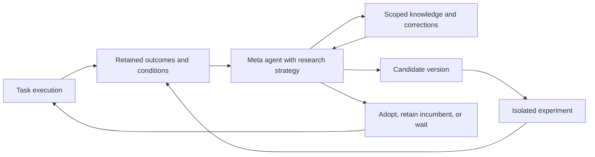

# E2E meta-analysis and improvement through the existing kernel

2026-10-31 design refinement. This extends
[the structural RSI proposal](procontract-rsi-structure-20261020.md) using the
recorded trajectory findings. It is a concrete architecture and qualification
plan, not an enabled autonomous campaign. No active benchmark version, runtime
prompt, adoption policy or kernel implementation changes in this document.

## Decision: one kernel, distinct responsibilities

Use the same domain-independent kernel for ordinary work and improvement work.
Improving a strategy, tool or harness is itself an authorized task with an artifact,
evidence and an eventual decision. A second kernel with Learn/Analyze/Improve
commands would embed a research workflow in the semantic core without a demonstrated
need for new general semantics.

This means the same kernel implementation, not one giant contract or one global
agent context. Ordinary task responsibilities and improvement responsibilities
have separate identities and may use appropriately separated stores/views. A
continuing improvement responsibility can study many outcomes; a scoped candidate
or adoption claim can have its own responsibility when useful. Individual reads,
ideas and tool calls do not each require another contract.

| Layer | Responsibility in the improvement system |
|---|---|
| Kernel | Responsibility, exact artifact/evidence bindings, authorized transitions and settlement provenance |
| Harness | Capture/read evidence, execute and reconcile operations, run isolated experiments, version effective configurations, preserve decisions/waits and perform authorized version selection |
| Strategy | Decide what is worth investigating, form/revise hypotheses, choose experiments and methods, interpret results, propose changes, and choose adoption/retention/waiting within authority |

Research scheduling remains replaceable context. A coordinator can be an ordinary
agent given research context and capabilities; it must not be another hard-coded
Host.step workflow interpreter.

## Two ways analysis enters later work

**Knowledge:** retain a scoped observation or interpretation with source identities,
conditions, contrary evidence and remaining uncertainty. Later strategy can retrieve
it when relevant. A lesson is not automatically a global instruction, new permission
or a certified general truth. A correction to an earlier interpretation can be a
useful result without changing software.

**Behavior changes:** changing a prompt/skill/effective context or harness build
creates a candidate version. Its stated claim is checked under an explicit experiment
assignment, then the appropriate authorized adoption decision can select it.
Saving an analysis note, updating the default strategy and replacing a harness
binary are distinct operations with distinct effects.

For example, the twelve-statement commit audit should enter knowledge as observed
matching commits and eleven contradicted discrepancy assertions. It should not
automatically add "always trust the previous executor" to all tasks. A proposed
state-focused context should be tested with both genuine and false mismatches.

## A complete improvement path, chosen by strategy

This depicts one useful path, not a required sequence. The agent may first
investigate measurement validity, build an observation capability, retain an
unresolved finding or conclude that no version change is useful. The harness
executes selected operations; it does not require every incident to cause a patch,
an independent critic, a paired benchmark or a promotion.

The data objects can remain small:

| Object | Required meaning |
|---|---|
| Version | Exact build/effective strategy and model/configuration identities, lineage and applicable capability schema |
| Observation | Actual outcome or explicitly labeled claim, its subject, source, conditions and resource use |
| Experiment | Explicit versions, inputs, conditions, measurement identity, purpose and original resource assignment |
| Decision | Selected action or interpretation, its evidence basis, authority and expected current version where relevant |

Hypotheses and falsifiers are strategy-authored artifacts linked to these objects.
They do not require kernel truth states. The experiment describes what is to run,
not a mandatory program choosing the following research step.

## Harness operations to extract or complete

The following are conceptual operations, not currently installed tool names:

- Read observations/versions since a retained cursor and retrieve selected detail,
  source snapshots, changes and conditions by identity.
- Register a candidate build/effective-context manifest from an isolated workspace.
- Submit an explicit experiment with a durable request identity; inspect, cancel
  or resume/reconcile that operation under its existing assignment.
- Retain an interpretation or selected next action linked to its actual evidence.
- Wait for a selected event/resource condition without keeping a model turn alive.
- Apply an authorized version-selection decision against the expected incumbent;
  return the same receipt after an identical retry and reject a stale decision.

Event delivery may repeat. Durable reservation and reconciliation must prevent a
repeated event from silently duplicating dispatched work or granting fresh resources.
Do not claim exactly-once external effects merely because control records are
idempotent. Unknown effects are inspected at the relevant scope before conflicting
work proceeds.

Subscriptions are selected under the improvement responsibility's authority. They
can cover useful checkpoints and operation outcomes as well as whole-task endings;
an open-ended task need not finish before anything can be learned from it. Retain
an incremental cursor and coalesce pending input for the same responsibility rather
than launching a new analyst for every low-level log line. This is generic event
delivery, not an every-N-tasks research schedule. The strategy decides which sources
to study, including its own method when useful; self-observation does not require
spawning an infinite chain of meta-agents.

An operation's outcome and the pending decision/wake state must be reconstructible
after process loss. A failed selector must not become a selected rest. Cleanup and
terminal recording cannot depend on the model being able to reason about its own
failure. If a recovery/backoff arrangement is needed, use the previously authorized
strategy arrangement rather than recursively asking another failed selector to
authorize recovery. The same primitives should support ordinary long tasks.

User time expectations remain context. A task deadline is optional. Action limits,
allocated compute and experiment-specific bounds remain enforceable when supplied.
Research work is charged to its admitted allocation; it does not borrow or renew a
finished solver's six-hour grant. New work respects later owner input/cancellation.

## Existing implementation: what can actually be reused

| Existing source | Reusable mechanism | Migration needed |
|---|---|---|
| scripts/procontract_rsi.py::Host.register | Content-addressed versions, lineage and partial-write reconciliation | New manifest for actual resolved context/builds; keep legacy IDs stable |
| Host.measure and experiment journals | Recorded execution, result custody and runner identities | Accept explicit assignments rather than choose research workflow/tasks inside generic operations |
| scripts/procontract_succession.py and pro-contract-store/store/adoption.rs | Adoption settles and selects the incumbent atomically, fenced by expected incumbent sequence and idempotency key | Separate domain policy/gates from the general selection operation; preserve authorization and existing settlement conditions |
| Archive readers and retained snapshots | Scoped retrieval and exact subject references | Scalable views and relevant context construction, preserving source conditions |
| Native execution/continuation adapter | Some interrupted executor recovery under the original grant | Finish operation finalization, pre-Issue/worker/selector continuity, durable pending decisions and event-driven resumption |

Old RSI currently chooses analyst/challenger/research/confirmation sequences in code,
and contains NOISE_FLOOR=0.087, PRIOR_RESCUE=(1,10), task-count assumptions and
harness.json workflow predicates. Those are historical research policies, not
general kernel/harness invariants to preserve in the new interface.

Old BUNDLE_FILES/TASK_FILES also omit current behavior-affecting contexts such as
work_method.md and continuation.md. A new manifest must capture the resolved prompt,
referenced skills/fallbacks, generated instruction sources, tool configuration and
build/model identities. Research strategy and task-solving strategy need distinct
identities so a changed analysis method cannot inherit an unearned task-performance
claim. Preserve prior manifests and their historical meaning.

Separate reproducible version definitions from per-run resolved inputs. A version
identifies code, instruction/skill definitions and resolver/configuration identities;
each run records the instructions actually delivered, retrieved source identities,
model/environment observations and their conditions. Changing external documents
does not require pretending that the whole world was frozen in a pre-run version
hash, and a filename-only manifest does not establish what the model received.

## Adoption, evidence and recursion boundaries

Use the user's standing authorization when present; the architecture does not
intrinsically require a new permission question for every iteration. An analysis
event does not create new editing, execution, evaluation or deployment authority.
Agents request operations; the host authenticates the actor and authority rather
than accepting a candidate's assertion that it is a human settler.

The existing kernel binds Support and Discharge and preserves its Reach/provenance
conditions. In particular, within-reach evidence cannot be automatically settled
by pretending a delegated act was explicit human acceptance. Scope the actual
claim correctly and satisfy its evidence/authorization conditions. An authorized
trial or scoped adoption is not a declaration of universal superiority.

Do not conflate improvements to measurement, execution reliability and task-solving
quality. Repairing grader connectivity can improve the validity of a measurement;
it does not by itself demonstrate a better solver. A candidate cannot certify its
own performance by rewriting the measurement or authority that judges that claim.
An evaluator or kernel change can itself be proposed as a versioned artifact under
the same kernel, while the current trusted host/measurement boundary handles its
admission and transition. No infinite stack of RSI kernels is required.

Adoption selects a version for its declared deployment scope. Existing attempts
remain pinned unless an explicitly authorized compatible migration is recorded;
there is no implicit reset of responsibility, evidence coordinates or resources.
The current 200-case fixed campaign must not silently adopt new versions or receive
meta-level hidden feedback in running solvers. Completed graded solvers remain
stopped; any repaired grading of frozen submissions is separately recorded.

## Smallest convincing E2E qualification

Use a known real failure such as publication cancellation/finalization as the first
improvement responsibility. Supply a research strategy and tools, not a script
that already knows the answer. A complete successful episode must leave:

1. A real task outcome that automatically wakes the admitted research responsibility.
2. An evidence-bound diagnosis and a candidate change or explicit decision not to change.
3. A registered candidate and explicit experiment assignment; a native control
   exercises the suspected mechanism under known valid observation conditions.
4. Recorded incumbent/candidate outcomes and actual costs; any claims about broader
   task quality additionally use appropriate fresh E2E evidence under the same conditions.
5. An authorized adoption or retained-incumbent decision. When adoption is chosen,
   the next admitted task actually records and uses the selected build/context.
6. A process-loss exercise around dispatch, result retention and adoption, showing
   no duplicated uncertain action, stale adoption, lost pending decision or renewed grant.

No manual editing between diagnosis and the next version's actual use is allowed
in the automation qualification. Retaining the incumbent after an unhelpful candidate
is a valid research outcome, not an automation failure. A successful automated
episode establishes operational closure; repeated useful transfer, costs and real
task outcomes are separate evidence for effective self-improvement.

To claim automatic rollout, actually exercise an authorized adoption followed by
a task using that version; an episode that only retains the incumbent does not
test that path. Deterministic/scripted controls can first qualify control-plane
mechanics, but the real research episode must include the model's analysis/change
and decision rather than a hand-authored candidate passed off as autonomous learning.

The two first prerequisites remain reliable execution continuity and qualified
measurement, including the recently identified evaluator-network issue. Build
the minimal general operations once, exercise them through a replaceable research
strategy, and then reuse the same machinery for further improvement work.
Bootstrap only the minimal trustworthy execution/evidence/adoption substrate; do
not require every future harness improvement to be completed before self-study can
begin. Conversely, a broken research runner cannot be assumed to repair its own
lost state merely because its prompt asks it to be persistent.
