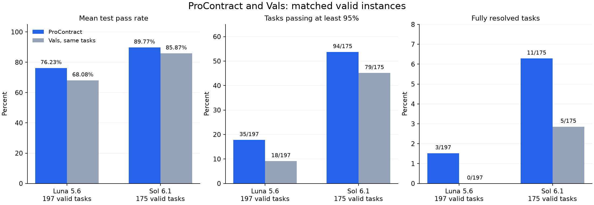
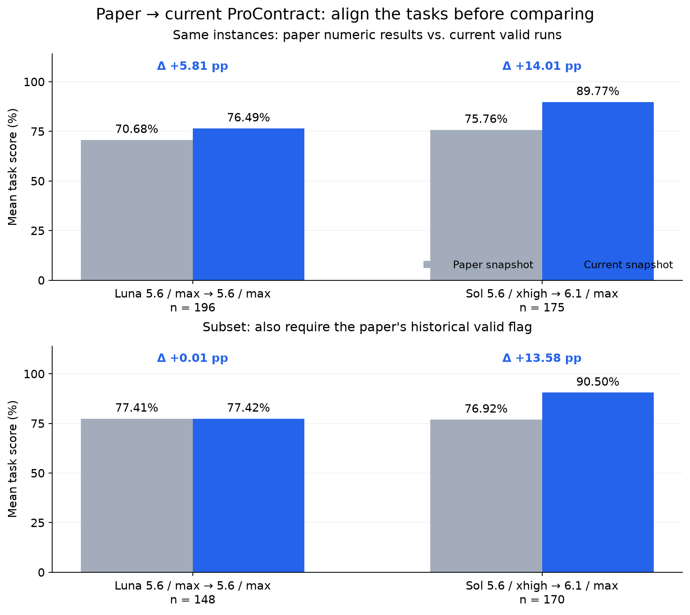
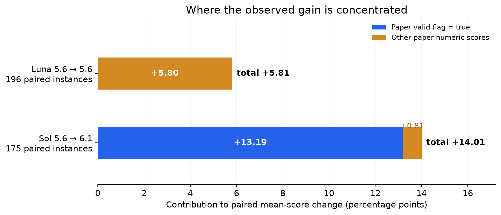
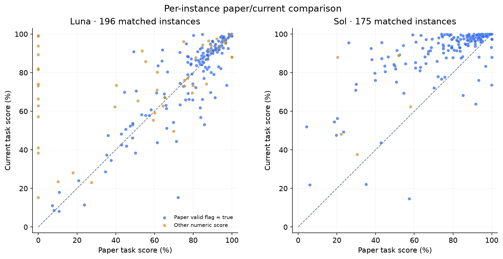

# ProContract: Paper Results, Current Runs, and Vals

> **Current snapshot: November 6, 2026, 20:56 UTC** · **Paper revision: 60b2721, September 26, 2026** · **Vals data updated: November 5, 2026**

**This report compares three sources: the paper's historical results, current valid runs, and Vals results on the same instances.**

[Current vs. Vals](#current-vs-vals-matched-instances) · [Paper results](#what-the-paper-reports) · [Aligned comparison](#paper-vs-current-matching-instances) · [Where the gains come from](#where-the-gains-are-concentrated) · [Data and sources](#data-and-sources)

## Current vs. Vals: matched instances

The current comparison includes valid runs only. Confirmed API failures and grading-configuration failures are excluded from model scores. Genuine implementation failures under a working environment remain in the results. A designated rerun replaces its earlier attempt even when its score is lower.

| Current configuration | Valid instances | ProContract mean | Vals, same instances | Difference | ≥95% tasks: ours / Vals | Full scores: ours / Vals |
|---|---:|---:|---:|---:|---:|---:|
| GPT-5.6 Luna / max | 197 | **76.23%** | 68.08% | **+8.15 pp** | 35 / 18 | 3 / 0 |
| GPT-6.1 Sol / max | 175 | **89.77%** | 85.87% | **+3.90 pp** | 94 / 79 | 11 / 5 |

The mean is the macro-average of per-instance test pass rates. Each Vals column uses exactly the corresponding set of instance IDs. These subset means therefore differ from the website's full 200-instance aggregate.

## What the paper reports

The following table reproduces the paper's [`selected_results_macros.tex`](https://github.com/Lemutisme/-ICLR27-ProContract/blob/60b2721bd1bcd29785f8054fd05ad1b141d11a56/contents/selected_results_macros.tex) and experimental tables. The paper's reported mean uses a **fixed denominator of 200 tasks**. The historical figures retain their original definitions.

| Paper configuration | Reported mean / 200 tasks | Raw full-score tasks | Tasks ≥95% | Numeric scores available | Historical `evaluator_valid` |
|---|---:|---:|---:|---:|---:|
| GPT-5.6 Luna / max | **70.20%** | 3 | 28 | 199/200 | 150/200 |
| GPT-5.6 Sol / xhigh | **75.25%** | 5 | 30 | 200/200 | 192/200 |
| GPT-5.6 Terra / max · v₂ | **75.72%** | 3 | 28 | 199/200 | 198/200 |

**Version mapping:** Luna is GPT-5.6/max → GPT-5.6/max. Sol is **GPT-5.6/xhigh → GPT-6.1/max**. The paper reports an OpenCode implementation; the current implementation is native ProContract in Codex. Terra is included as historical context; this round contains no new Terra runs.

In the paper's RQ3 comparison, the official GPT-5.6 Sol/xhigh baseline is **69.89%**, versus **75.25%** for ProContract; see the [paper text](https://github.com/Lemutisme/-ICLR27-ProContract/blob/60b2721bd1bcd29785f8054fd05ad1b141d11a56/contents/4_exp.tex#L71). The current Vals GPT-6.1 Sol comparison is labeled separately above.

## Paper vs. current: matching instances

This comparison uses identical instance IDs for which the **current run is valid and the paper has a numeric score**. Missing paper scores are not filled with zero. The matched sets contain 196 Luna instances and 175 Sol instances.

| Matched comparison | Instances | Paper mean | Current mean | Change | Improved / tied / declined | ≥95%: paper → current | Full: paper → current |
|---|---:|---:|---:|---:|---:|---:|---:|
| Luna 5.6 → 5.6 | 196 | 70.68% | **76.49%** | **+5.81 pp** | 125 / 1 / 70 | 27 → 35 | 3 → 3 |
| Sol 5.6 → 6.1 | 175 | 75.76% | **89.77%** | **+14.01 pp** | 162 / 1 / 12 | 23 → 94 | 4 → 11 |

A supplementary view also requires the paper's historical `evaluator_valid=true` flag. This flag is retained as a grouping variable; it is not the same definition as the current API/configuration validity rule.

| Matched instances with the paper's valid flag | Instances | Paper mean | Current mean | Change |
|---|---:|---:|---:|---:|
| Luna | 148 | 77.41% | 77.42% | **+0.01 pp** |
| Sol | 170 | 76.92% | 90.50% | **+13.58 pp** |

## Where the gains are concentrated

**Luna gains +5.81 points overall on matched instances, while the historical valid-flag subset is nearly unchanged on average.** Across those 148 tasks, the mean moves from 77.41% to 77.42%, with 91 improvements and 57 declines. The other 48 matched tasks, which have numeric paper scores but a false historical valid flag, move from 49.93% to 73.62%. They contribute approximately +5.80 points to the overall matched gain.

**Sol's improvement is broader.** Its 175 matched tasks improve by +14.01 points. The 170 tasks with the paper's valid flag still improve by +13.58 points, and the number reaching 95% rises from 23 to 94. The figures explicitly retain the model change from 5.6 to 6.1; these are changes in the deployed configurations as a whole.

Show per-instance scatter plots and example changes

The horizontal axis is the paper score; the vertical axis is the current score. Points above the dashed line favor the current result. Color indicates only the paper's historical valid flag.

| Model series | Instance | Paper | Current | Change | Paper valid flag |
|---|---|---:|---:|---:|---|
| Luna | `oppiliappan__eva.41ae245` | 0.00% | 99.23% | +99.23 pp | false |
| Luna | `altdesktop__i3-style.f93821b` | 0.00% | 98.89% | +98.89 pp | false |
| Luna | `sharkdp__hyperfine.327d5f4` | 0.00% | 93.81% | +93.81 pp | false |
| Luna | `tinycc__tinycc.9b8765d` | 72.14% | 15.27% | -56.88 pp | true |
| Luna | `hairyhenderson__gomplate.05eb3aa` | 85.82% | 53.04% | -32.78 pp | true |
| Luna | `kisielk__errcheck.dacab89` | 83.82% | 56.76% | -27.06 pp | true |
| Sol | `rs__jplot.2a54bcc` | 26.07% | 95.54% | +69.47 pp | true |
| Sol | `osgeo__proj.75d455c` | 20.36% | 87.95% | +67.59 pp | false |
| Sol | `stathissideris__ditaa.f2286c4` | 37.60% | 92.61% | +55.01 pp | true |
| Sol | `go-critic__go-critic.9aea378` | 57.40% | 14.60% | -42.80 pp | true |
| Sol | `tomarrell__wrapcheck.c058da1` | 91.67% | 63.75% | -27.92 pp | true |
| Sol | `tree-sitter__tree-sitter.5e23cca` | 99.92% | 73.62% | -26.30 pp | true |

## Implications for further improvement

- **Bring more tasks to evaluable artifacts while preserving progress.** Luna's aggregate improvement is concentrated outside the paper's historical valid-flag subset. Within that subset, regression magnitudes matter as well as the number of wins.
- **Find shared structure and common entry points.** Chroma uses public XML definitions to build a state interpreter. Gromacs's input-version boundary and go-critic's toolchain selection show how one shared entry point can affect an entire feature area.
- **Verify the actual execution target and conditions.** Some jplot ref/new probes accidentally ran the reference on both sides. The exact graded go-critic binary fails on Go 1.24 modules because its own code forces `GOTOOLCHAIN=local`. Genuine implementation failures remain in the valid-result statistics.
- **Preserve the layer boundaries.** Recovery, target binding, and lossless artifact transport belong to the harness. Experiment selection, diagnosis, repair, and workflow choices belong to strategy. These observations do not require domain-specific kernel rules.

## Data and sources

- [Per-instance CSV](data/instances.csv): paper, current, and Vals scores for all 200 instance IDs, with their respective flags.
- [Summary JSON](data/summary.json) · [Paper-aligned data](data/paper-aligned.json) · [Paper per-instance data](data/paper-task-scores.json).
- [Sources and SHA-256 hashes](data/sources.json) · [Publication manifest](data/manifest.json).
- [Vals ProgramBench](https://www.vals.ai/benchmarks/programbench).
- The paper source is pinned to [`60b2721`](https://github.com/Lemutisme/-ICLR27-ProContract/blob/60b2721bd1bcd29785f8054fd05ad1b141d11a56/contents/4_exp.tex). That source repository is private; the comparison data needed for this report are included here.

Historical definitions and reproducibility

The paper's per-instance data come from its retained frozen dataset. Its hash matches the retained figure manifest, and its aggregates reproduce the pinned manuscript's mean, full-score count, ≥95% count, numeric-score count, and evaluator-valid count. The three selected historical cohorts used for alignment are bundled with this report.

The historical archive labels the Luna and Sol cohorts `known_online_source_acquisition`, and Terra `isolated_configuration`. Their source labels and historical values are retained. The original 200-task mean, same-ID comparison, and historical-valid grouping remain separate views.

The current view uses the designated rerun result rather than the higher of old and new scores. Low scores from functioning environments remain included. Confirmed API and grading-configuration failures are excluded from the current primary comparison. This page is a fixed snapshot at the timestamp above.

The paper-comparison figures can be regenerated from the bundled data using `generate_charts.py`, with Python, Matplotlib, and NumPy.
